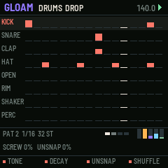
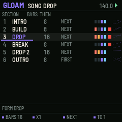
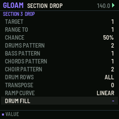
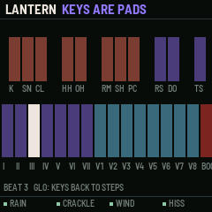
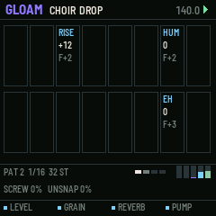
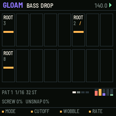
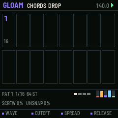
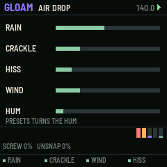

# GLOAM

A groovebox firmware for the M-VAVE FM-1, for witch house and melodic dubstep: the half-lit, rain-on-the-window
end of electronic music (Purity Ring, Burial, the witch house tapes, melodic dubstep's big minor chords). It makes
its own sound, sends MIDI, and has an arranger that can play a whole track by itself or follow you live.

**Status: 0.1, untested on hardware.** It builds for the FM-1 (code 210 KB of 581 KB; fast RAM 204 KB of 344 KB),
passes its host-simulator tests, and its sound was checked in the simulator (levels, pitch of the choir, no
overflow). The CPU load of the choir's grains and the reverb together on a real FM-1 is not measured yet: try that
first.

## What it is for

Both styles live in texture, timing and treated voices more than in notes. GLOAM makes those the instrument:

- **Voices as an instrument.** The CHOIR sings slices of a vocal bank, pitch and formant apart, so a phrase can go up
  without turning into a chipmunk, or down into a ghost.
- **Time that breathes.** Every drum hit keeps its own small drift; UNSNAP sets how much of it you hear, from a grid
  to Burial's hand-placed looseness. Nudges move a hit off the grid on purpose; a shuffle swings the off-beats.
- **SCREW.** One dial slows the tempo and lowers every pitch together, the witch house move. A tape stop does it in a
  beat.
- **Weather.** AIR is rain, vinyl crackle, hiss, wind and mains hum, made from noise (the FM-1 has no microphone).
- **Pressure.** The kick ducks the chords, bass, choir and air (each by its own amount), and the reverb can freeze.
- **Form.** The arranger turns patterns into a track: builds, drops, breaks, and transitions into each.

## The lanes

| Lane | Steps | A step holds | The lane's knobs |
| --- | --- | --- | --- |
| DRUMS | 8 sounds (kick, snare, clap, hat, open hat, rim, shaker, perc) | velocity, nudge (half a step either way), roll (2-6 hits, optionally falling in pitch), drift | tone, decay, UNSNAP, shuffle |
| BASS | one line | a tone of the chord (root, 3rd, 5th, 7th...) or of the key, length, glide or octave, its own wobble rate | mode (808, REESE, WOBBLE), cutoff, wobble depth, wobble rate |
| CHORDS | one line | a degree (I-VII and an octave up), colour (7, sus2, sus4, add9, flip), length, velocity | wave, cutoff, spread, release |
| CHOIR | one line | a slice, pitch, formant, length; reverse; follow the chord | level, grain size, reverb send, duck |
| AIR | none | | rain, crackle, wind, hiss (PRESETS: hum) |

Each lane has 8 patterns of up to 64 steps at 1/16, 1/16 triplets, 1/32 or 1/8. Chords voice-lead (each change
stays close to the last). The bass and choir follow the chord.

## The arranger

A song is up to 32 sections. Each section has:

- a **pattern for each lane** (or the lane silent), the **drum rows** heard, a **transpose**;
- **bars** (1-64) and **repeats** (1-16);
- a **follow action** for when it is done: NEXT, LOOP, JUMP TO a section, RANDOM IN a range, CHANCE TO (a percentage,
  else next), FIRST, BACK (n), STOP;
- **transitions** into whatever comes next, any of: DRUM FILL (snares closing in over the last half bar), RISER (a
  noise sweep over the last two bars), REVERSE SWELL (the chords bloom into the reverb on the last beat), DROPOUT
  (silence on the last beat but the choir and air), TAPE STOP (the last beat slows to a halt), IMPACT (a boom on the
  next downbeat), FILTER SWEEP (the master low-pass opens across the last bar);
- **eight macros ramped** across it, each from a value to a value along a curve (linear, ease in, ease out, at the
  end, S): SCREW, FILTER, AIR, REVERB, ENERGY (low energy drops the quiet hits first), PUMP, CHOIR, WOBBLE. A macro
  left "as set" keeps the value you set by hand.

Live:

- **White keys on the song page launch a section** at the next bar (or the next beat with AT ONCE). The waiting
  section blinks.
- **HOLD** keeps the section playing. **JAM** (follow off) makes every section loop until you launch another.
- **Record the arrangement**: launch sections as you like; stop recording and the song becomes what you played,
  each section with the bars it ran.
- **Forms** rewrite the song from the patterns there are: DROP (intro, build, drop, break, drop, outro), LOOP (a
  groove that varies itself at random), WITCH (slow, screwed, drowned, ending), GHOST (sections that drift in and
  out by chance, Burial-like). Undoable.

## The controls

Hold any button alone for a second for its card on the screen; hold a modifier and the bottom line says what it does.

| Control | What it does |
| --- | --- |
| SEQ | the LANE page. ALGO the lane; PRESETS its pattern in the section playing; OCT the page of 16 steps |
| black keys (lane page) | DRUMS: the sound to edit. BASS: a chord tone. CHORDS: a degree. CHOIR: a slice (9 reverse, 10 follow) |
| white keys (lane page) | steps: tap to set or clear; hold and turn K1-K4 for the step's values; hold and press a black key to set its tone/degree/slice |
| HOME | the SONG page: ALGO the cursor; K1 bars, K2 repeats, K3 follow, K4 target; white keys launch; black keys: 1 HOLD, 2 AT ONCE, 3 RECORD ARRANGEMENT, 4 insert, 5 delete, 6-7 move, 8 next form, 9 song follows / jam |
| EDIT | the SECTION page: every field of a section, including the transitions and each macro's FROM and TO |
| ENV / LFO | the lane's SOUND page / SETUP (tempo, key, scale, reverb, clock, slots, bank) |
| GLO | LANTERN: every key a lit pad. White 1-7 chords I-VII, 8-15 choir slices, 16 impact; black 1-8 drums, 9 riser, 10 dropout (held), 11 tape stop (held). With REC, hits land in the patterns exactly where you played them (nudged off the grid). GLO held + black 1-5: mute lanes |
| FX held | white 1 FREEZE (held), 2 SWELL, 3 RISER, 4 TAPE STOP (held), 5 DROPOUT (held), 6 IMPACT; K1 reverb size, K2 filter, K3 pump, K4 air |
| SELECT | SCREW (SEL held: UNSNAP) |
| ARP | generate the lane's pattern (drums in turn: 2-STEP, HALF-TIME, WITCH); on the song page, apply the form. SEL + ARP: undo |
| PLAY / REC / SAVE | play from the song cursor or the section playing / record / save to the slot (at the stop if playing) |

MIDI: drums on channel 10 (General MIDI notes), bass 2, chords 3, choir 4 (set on each lane's SOUND page). MIDI in
plays the lane shown. Clock in and out.

## Screens

## The vocal bank

The choir sings from a bank of up to 16 slices (about 12 seconds at 16 kHz, 8-bit) kept in its own flash region,
which the installer writes after the firmware. The factory bank is sung by GLOAM's own
formant synthesiser (`tools/make_bank.py`): long vowels, rises, falls, calls and hums, no recordings of anyone. To
use your own voices (your recordings, or samples you have the right to use), put up to 16 WAV files in a folder:

`./build.sh --bank path/to/wavs --release 0.1` in the source, then install the package and bank it makes.

Each file is resampled, its pitch found (so the grains lock to it) and packed in name order. Until a bank is written,
GLOAM sings four built-in vowels.

## Install

Use the [installer page](../install/) in Chrome or Edge with the FM-1 connected by USB. It writes the firmware, then
the choir's vocal bank. Keep M-VAVE's stock firmware and M-UPGRADE at hand: the installer can put it back.

To build it yourself, see the [source](https://github.com/davidpryan/gloam).
